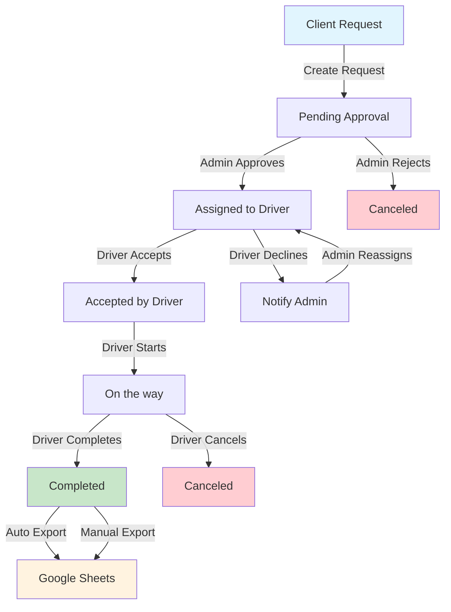
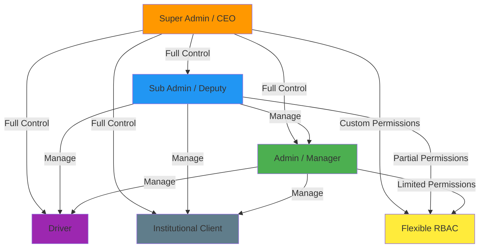
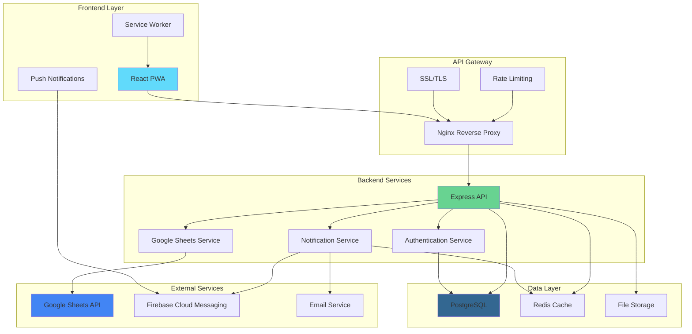
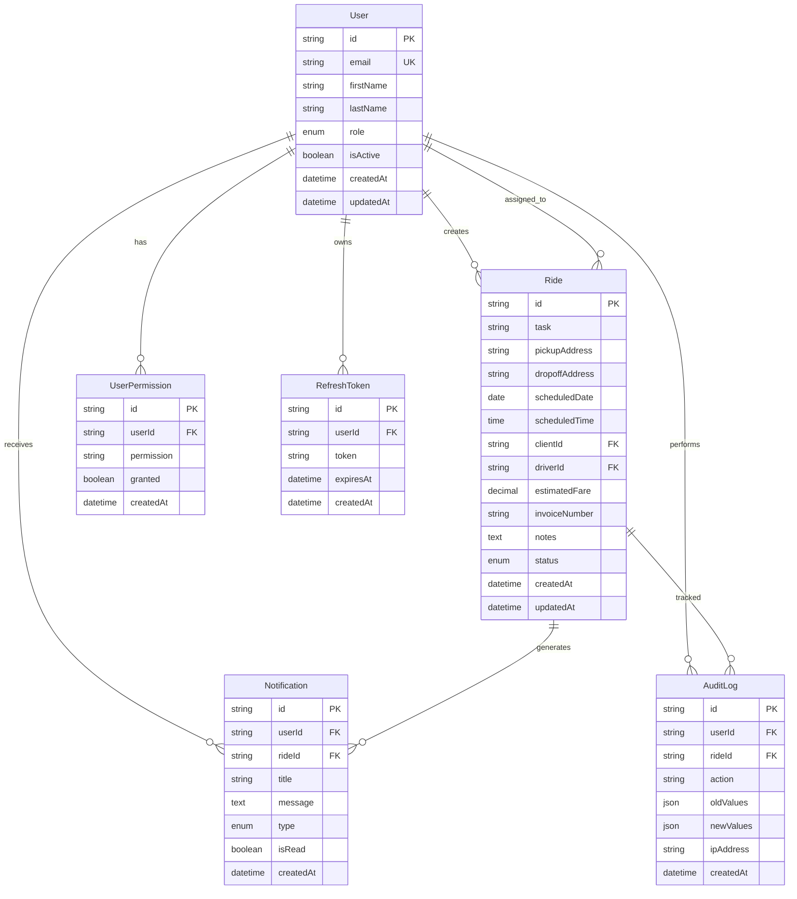
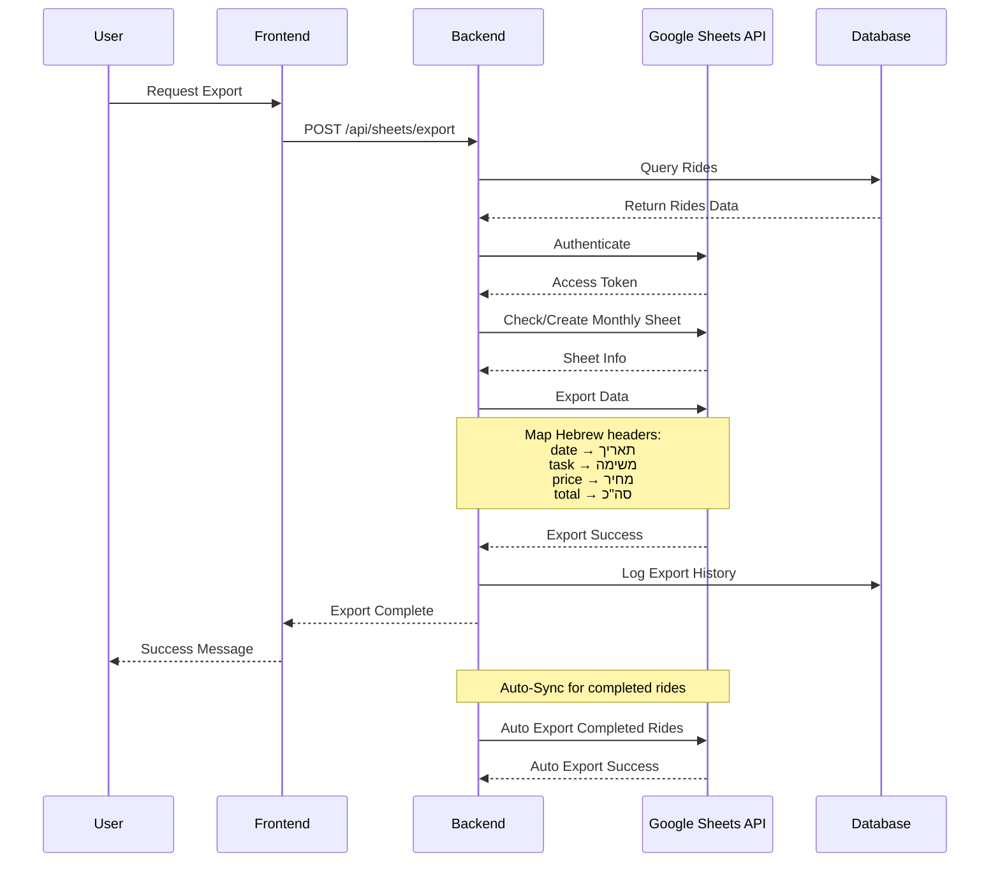
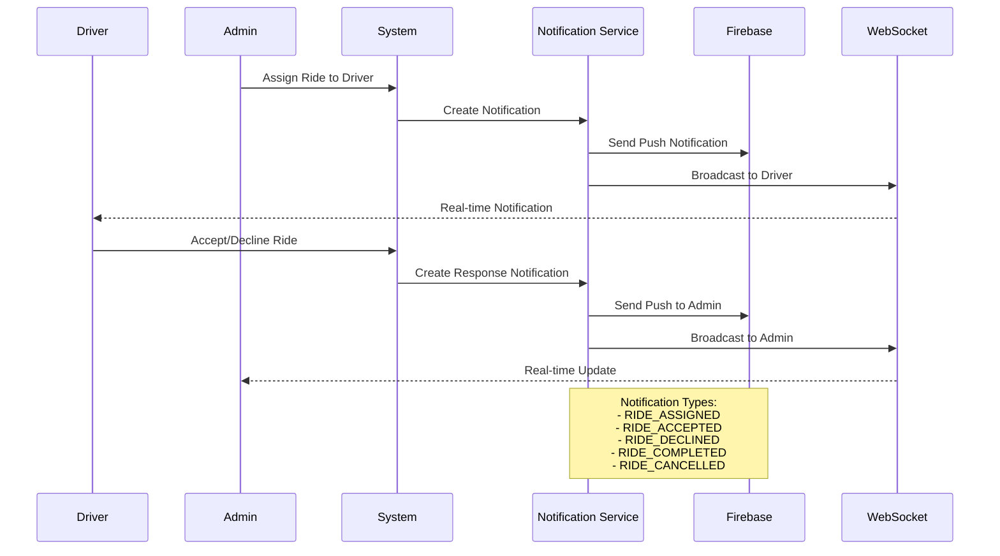
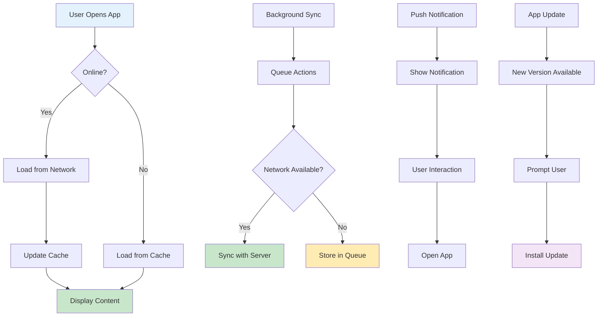
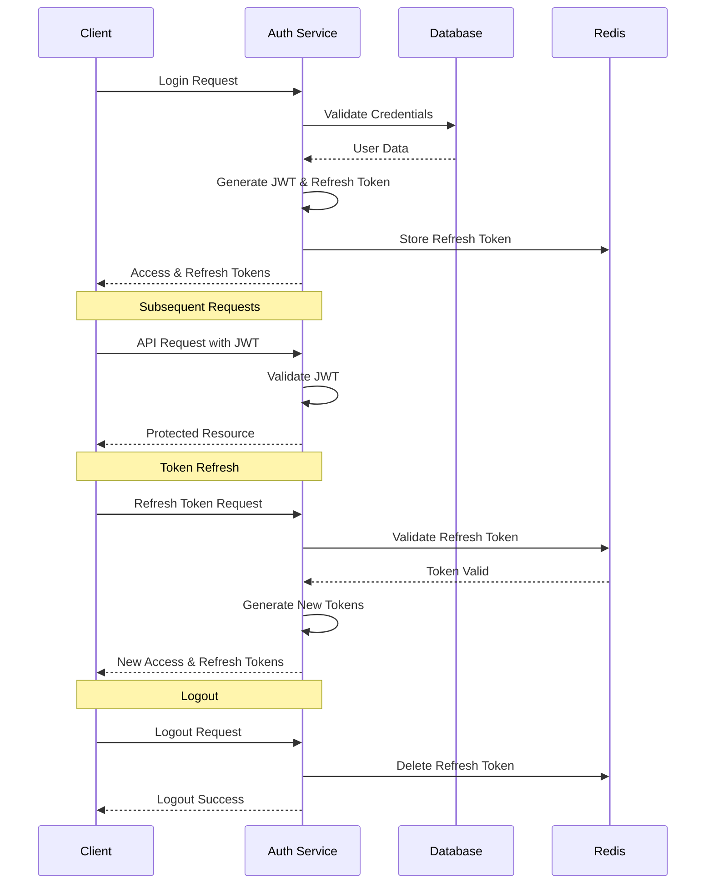
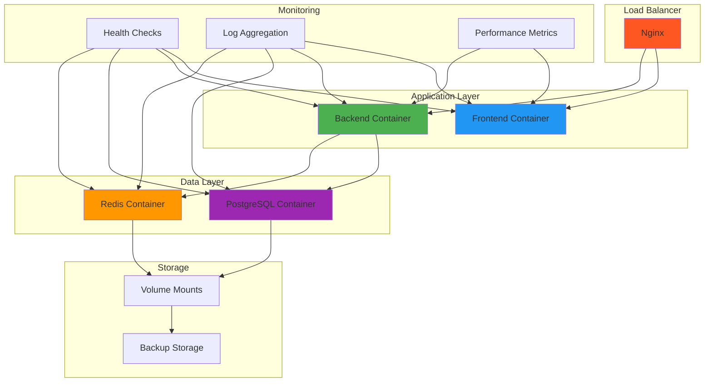
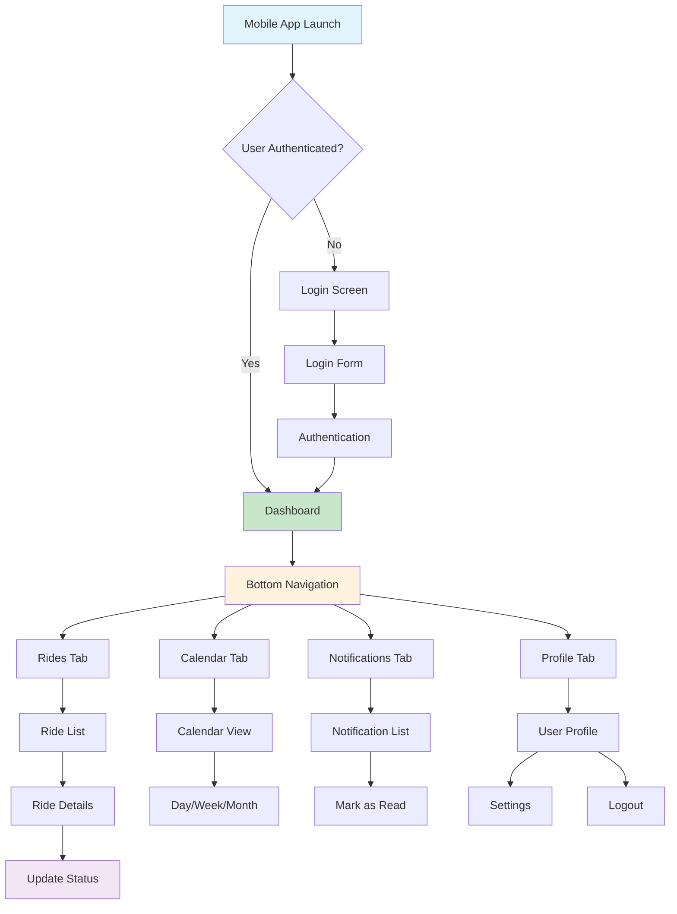

# Ambulance Manager - System Diagrams

## 1. Ride Lifecycle Flow

## 2. User Hierarchy & Permissions

## 3. System Architecture

## 4. Database Schema

## 5. Google Sheets Integration Flow

## 6. Notification System Flow

## 7. PWA Service Worker Flow

## 8. Security & Authentication Flow

## 9. Deployment Architecture

## 10. Mobile-First UI Flow

---

## Diagram Usage

### How to Use These Diagrams

1. **Ride Lifecycle**: Shows the complete flow of a ride from creation to completion
2. **User Hierarchy**: Displays the organizational structure and permission levels
3. **System Architecture**: Illustrates the technical architecture and component relationships
4. **Database Schema**: Shows the data model and relationships between entities
5. **Google Sheets Integration**: Details the export process and data mapping
6. **Notification System**: Explains how real-time notifications work
7. **PWA Service Worker**: Shows offline functionality and app updates
8. **Security Flow**: Details authentication and authorization processes
9. **Deployment Architecture**: Shows production deployment structure
10. **Mobile UI Flow**: Illustrates the mobile-first user experience

### Tools for Viewing

- **Mermaid Live Editor**: https://mermaid.live/
- **VS Code Extension**: Mermaid Preview
- **GitHub**: Native Mermaid support in markdown files
- **Documentation Sites**: Most support Mermaid rendering

### Customization

These diagrams can be customized by:
- Modifying the Mermaid syntax
- Adding new components or flows
- Updating colors and styling
- Adding new diagram types as needed
